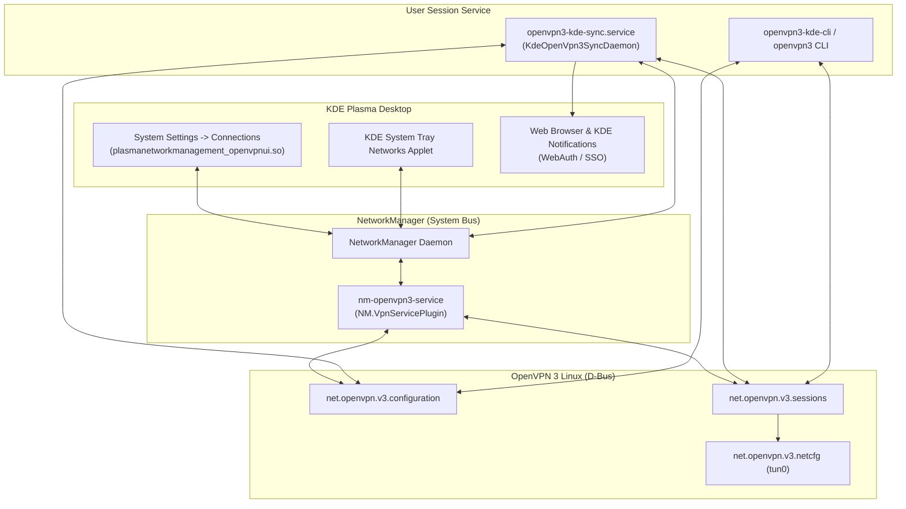

# OpenVPN 3 KDE Connection Manager Integration (`openvpn3-kde-nm`)

[](CHANGELOG.md)
[](LICENSE)
[](https://www.python.org/)
[](https://kde.org/)

Native integration between **OpenVPN 3 Linux (`openvpn3`)** and **KDE Connection Manager (`plasma-nm` / NetworkManager)**.

Manage, connect, disconnect, and monitor your OpenVPN 3 profiles directly from **KDE System Settings -> Connections** and the **KDE Plasma Networks System Tray Applet**, just like OpenVPN 2—with full support for **OpenVPN Cloud / CloudConnexa**, **WebAuth / SSO browser login**, and **bidirectional CLI synchronization**.

---

## Why This Exists

KDE Connection Manager (`plasma-nm`) and `network-manager-openvpn` are built around classic OpenVPN 2.x (`/usr/sbin/openvpn`), which:
1. Strips directives required by OpenVPN Cloud / CloudConnexa such as `setenv USERNAME "..."` and `socket-flags TCP_NODELAY` when importing `.ovpn` files.
2. Does not integrate with OpenVPN 3's D-Bus architecture (`net.openvpn.v3.configuration`, `net.openvpn.v3.sessions`, `net.openvpn.v3.netcfg`).
3. Does not show sessions started via `openvpn3 session-start` as **Connected** inside the KDE Networks tray applet or KDE System Settings.

`openvpn3-kde-nm` bridges `org.freedesktop.NetworkManager.openvpn` to OpenVPN 3 so KDE's built-in `VPN (openvpn)` UI and system tray widget natively control `openvpn3`.

---

## Architecture



---

## Key Features

- **Native KDE Connections & System Tray Control**:
  - Existing `openvpn3` profiles (`openvpn3 configs-list`) automatically appear under **VPN** in KDE System Settings -> Connections and the KDE Networks tray widget.
  - Clicking **Connect** or **Disconnect** in KDE starts or stops the OpenVPN 3 session.
  - Already-running sessions started from the terminal (`openvpn3 session-start --config <name>`) automatically attach and display as **Connected** in KDE without dropping packets or resetting routes.
- **Bidirectional Deletion & Profile Sync**:
  - Deleting a VPN connection in **KDE System Settings -> Connections** automatically disconnects any active session and removes the configuration from `openvpn3` (`openvpn3 configs-list`).
  - Removing a profile via `openvpn3 config-remove` removes it from KDE Connection Manager.
- **CloudConnexa / OpenVPN Cloud & X.509 CN Recovery**:
  - Preserves `setenv USERNAME "..."`, `socket-flags TCP_NODELAY`, `push-peer-info`, `persist-tun`, and inline certificates (`<ca>`, `<cert>`, `<key>`, `<tls-auth>`, `<tls-crypt>`).
  - If a profile is imported via KDE's built-in *"Import VPN connection..."* button (which strips `setenv USERNAME`), `openvpn3-kde-nm` automatically recovers the CloudVPN username from the X.509 `Subject CN` of the extracted `cert.pem`.
- **Automatic WebAuth / SSO Browser Login**:
  - Listens for `StatusMajor.SESSION / StatusMinor.SESS_AUTH_URL` D-Bus signals, opens the authentication URL in your default browser, and displays a native KDE desktop notification.
- **Live Traffic Statistics & Logs CLI (`openvpn3-kde-cli`)**:
  - Inspect integration status, watch real-time session byte/packet counters, and tail session logs.

---

## Prerequisites

- **OS**: Linux with **KDE Plasma** (`plasma-nm`) and **NetworkManager** (`network-manager-openvpn`)
- **OpenVPN 3 Linux**: `openvpn3-client` (including `python3` `openvpn3` D-Bus bindings)
- **Python 3.10+** with system packages:
  - `python3-gi` (`gi.repository.NM`, `GLib`, `Gio`)
  - `python3-dbus` (`dbus-python`)
  - `openssl` CLI

---

## Installation

Prebuilt native packages for **Debian / Ubuntu (`.deb`)** and **Arch Linux (`.pkg.tar.zst` + `PKGBUILD`)** are automatically built, tested, and attached to every [GitHub Release](https://github.com/gerosalesc/openvpn3-kde-nm/releases).

### Option 1: Debian / Ubuntu (`.deb` Package — Recommended)

Supports **Debian 13 (Trixie)**, **Ubuntu 26.04 LTS (Resolute)**, **Ubuntu 24.04 LTS (Noble)**, Linux Mint 22.x, Kubuntu, and KDE Neon.

Download `openvpn3-kde-nm_<version>-1_all.deb` from the latest [GitHub Release](https://github.com/gerosalesc/openvpn3-kde-nm/releases) and install it with `apt`:

```bash
sudo apt install ./openvpn3-kde-nm_<version>-1_all.deb
```

*(On Ubuntu 24.04 LTS / Debian 12 where `openvpn3-client` is not in the default distro archive, first enable the [official OpenVPN 3 APT repository](https://community.openvpn.net/openvpn/wiki/OpenVPN3Linux).)*

The `.deb` package automatically:
- Installs `openvpn3-kde-cli`, `openvpn3-kde-sync`, and `/usr/libexec/nm-openvpn3-service` system-wide.
- Hooks NetworkManager cleanly via `dpkg-divert` (survives `network-manager-openvpn` upgrades and restores OpenVPN 2 cleanly on removal).
- Enables and starts the global systemd user daemon `/usr/lib/systemd/user/openvpn3-kde-sync.service`.

### Option 2: Arch Linux (`.pkg.tar.zst` or `PKGBUILD`)

1. Install the `openvpn3` prerequisite from the AUR (e.g., `yay -S openvpn3`).
2. Download the prebuilt package from the latest [GitHub Release](https://github.com/gerosalesc/openvpn3-kde-nm/releases) and install with `pacman`:

```bash
sudo pacman -U openvpn3-kde-nm-<version>-1-any.pkg.tar.zst
```

Or build directly from the release's `PKGBUILD` + `openvpn3-kde-nm.install` (or `openvpn3-kde-nm-<version>-aur-src.tar.gz`):

```bash
makepkg -si
```

The Arch package automatically installs a pacman ALPM hook (`/usr/share/libalpm/hooks/90-openvpn3-kde-nm.hook`) so the NetworkManager OpenVPN 3 hook survives `networkmanager-openvpn` upgrades and restores OpenVPN 2 cleanly on `pacman -R openvpn3-kde-nm`.

### Option 3: Install from PyPI (via `pipx`)

Because `openvpn3`, `gi` (PyGObject), and `dbus` come from system packages (`/usr/lib/python3/dist-packages/`), install with `--system-site-packages` and then run `openvpn3-kde-cli install` to register the systemd user daemon and NetworkManager root plugin hook:

```bash
pipx install --system-site-packages openvpn3-kde-nm
openvpn3-kde-cli install
```

### Option 4: Install from Source

```bash
git clone git@github.com:gerosalesc/openvpn3-kde-nm.git
cd openvpn3-kde-nm
./install.sh
```

### What `openvpn3-kde-cli install` / `./install.sh` Does
1. Installs and enables the user systemd service `~/.config/systemd/user/openvpn3-kde-sync.service`.
2. Synchronizes your existing `openvpn3` configurations (`openvpn3 configs-list`) with KDE Connection Manager.
3. Uses PolicyKit (`pkexec`) or `sudo` to:
   - Install the Python package to `/usr/local/lib/openvpn3-kde-nm` (so NetworkManager can execute it inside its `ProtectHome=read-only` systemd sandbox).
   - Back up `/usr/libexec/nm-openvpn-service` and `/usr/lib/NetworkManager/VPN/nm-openvpn-service.name` to `/var/backups/`.
   - Register `/usr/local/libexec/nm-openvpn3-service` as NetworkManager's OpenVPN service plugin.

---

## Usage

### Managing Connections in KDE
- **Connect / Disconnect**: Open the **KDE Networks** system tray icon (or **System Settings -> Connections**), find your OpenVPN 3 profile, and click **Connect** or **Disconnect**.
- **Remove a Profile**: Right-click or select the profile in **System Settings -> Connections** and click **Delete**. It will be removed from both KDE Connection Manager and `openvpn3`.

### CLI Reference (`openvpn3-kde-cli`)

```bash
# Check integration status, synced profiles, and active sessions
openvpn3-kde-cli status

# Watch live traffic statistics (refreshes every second)
openvpn3-kde-cli stats --watch

# Show statistics for a specific profile
openvpn3-kde-cli stats --config ClassMiami4

# Follow live service and session logs
openvpn3-kde-cli logs -f

# Manually trigger profile synchronization
openvpn3-kde-cli sync

# Import a new .ovpn file into both OpenVPN 3 and KDE Connections
openvpn3-kde-cli import /path/to/profile.ovpn --name MyVPN

# Register / update NetworkManager hook and systemd daemon
openvpn3-kde-cli install

# Remove NetworkManager hook and restore OpenVPN 2
openvpn3-kde-cli uninstall

# Display version
openvpn3-kde-cli --version
```

---

## Uninstallation

To remove the integration and cleanly restore the original OpenVPN 2 NetworkManager service:

- **Debian / Ubuntu (`.deb`)**:
  ```bash
  sudo apt remove openvpn3-kde-nm
  ```
- **Arch Linux**:
  ```bash
  sudo pacman -R openvpn3-kde-nm
  ```
- **PyPI (`pipx`) or Source**:
  ```bash
  openvpn3-kde-cli uninstall
  # Optional if installed via pipx:
  pipx uninstall openvpn3-kde-nm
  ```
  *(Or `./uninstall.sh` from the source checkout.)*

---

## Project Layout

```text
openvpn3-kde-nm/
├── bin/
│   ├── nm-openvpn3-service          # NetworkManager VPN service executable
│   ├── openvpn3-kde-cli             # CLI management utility
│   └── openvpn3-kde-sync            # User session sync & WebAuth daemon
├── openvpn3_kde_nm/
│   ├── data/
│   │   └── openvpn3-kde-sync.service # Bundled systemd user unit template
│   ├── __init__.py                  # Package version metadata
│   ├── cli.py                       # CLI implementation (status, stats, logs, sync, import, install, uninstall)
│   ├── config_sync.py               # Bidirectional OpenVPN 3 <-> NetworkManager sync
│   ├── installer.py                 # Self-contained installer & uninstaller logic
│   ├── nm_vpn_service.py            # NM.VpnServicePlugin D-Bus implementation
│   ├── ovpn_parser.py               # .ovpn parser, PEM extractor, X.509 CN recovery
│   └── session_watcher.py           # Session event watcher & WebAuth handler
├── packaging/
│   ├── arch/                        # Arch Linux PKGBUILD.in, .install, and ALPM hook
│   ├── common/                      # Shared nm-hook.sh and system systemd user unit
│   ├── debian/                      # Debian/Ubuntu control, maintainer scripts, triggers
│   ├── tests/                       # Container and local package lifecycle tests
│   ├── build-arch.sh                # Arch Linux package & AUR bundle builder
│   └── build-deb.sh                 # Debian/Ubuntu .deb package builder
├── systemd/
│   └── openvpn3-kde-sync.service    # systemd user unit
├── CHANGELOG.md
├── LICENSE
├── README.md
├── install.sh
├── pyproject.toml
└── uninstall.sh
```

---

## License

Released under the [MIT License](LICENSE).
